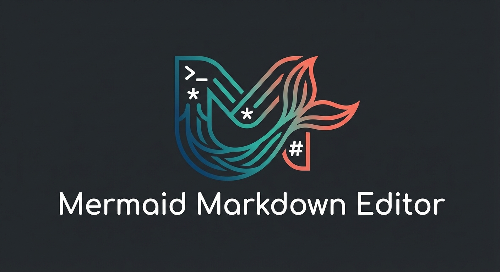
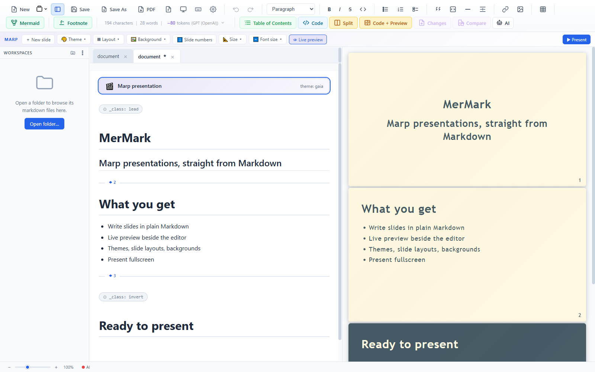
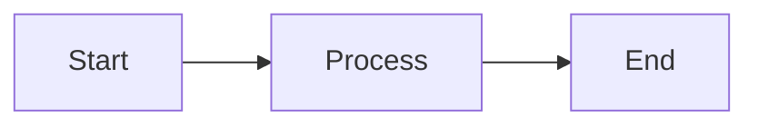

<p align="center">
  
</p>

<p align="center">
  <strong>Mermaid ダイアグラムを標準サポートした、モダンなオープンソース Markdown エディター</strong>
</p>

<p align="center">
  <a href="https://github.com/Vesperino/MerMarkEditor/releases"></a>
  <a href="https://github.com/Vesperino/MerMarkEditor/blob/master/LICENSE"></a>
  <a href="https://github.com/Vesperino/MerMarkEditor/stargazers"></a>
  <a href="https://github.com/Vesperino/MerMarkEditor/releases"></a>
  <a href="https://buymeacoffee.com/vesperinio"></a>
</p>

<p align="center">
  <a href="#ローカル-ai-アシスタント">AI アシスタント</a> •
  <a href="#プレゼンテーション-marp">プレゼンテーション</a> •
  <a href="#機能">機能</a> •
  <a href="#スクリーンショット">スクリーンショット</a> •
  <a href="#インストール">インストール</a> •
  <a href="#使い方">使い方</a> •
  <a href="#開発">開発</a>
</p>

<p align="center">
  <a href="README.md">English</a> •
  <a href="README_PL.md">Polski</a> •
  <a href="README_ZH.md">中文</a> •
  <strong>日本語</strong>
</p>

---

## MerMark Editor を選ぶ理由

**MerMark Editor** は、Markdown の手軽さと Mermaid ダイアグラムの表現力を、美しいネイティブデスクトップアプリにまとめたエディターです。フローチャートやシーケンス図を含むドキュメントを書く開発者やテクニカルライターはもちろん、図を交えて説明したいすべての人に向いています。

### 主なメリット

- **クラウド不要** - ドキュメントは手元の PC に保存されます
- **ネイティブの軽快さ** - Tauri 製なので、高速かつ軽量に動作します
- **WYSIWYG 編集** - 入力したそばから書式が反映されます
- **Mermaid 統合** - ドキュメント内で直接ダイアグラムを作成できます
- **Marp プレゼンテーション** - Markdown でスライドを作成し、ライブプレビューで確認しながら全画面でプレゼンできます
- **マルチルートワークスペース** - フォルダーは 1 つでも複数でも開けます。AI からは範囲を限定した読み取り専用のコンテキストとして参照されます
- **ローカル AI アシスタント** - Claude、Codex、完全オフラインの Ollama モデル、または任意の OpenAI 互換ローカルサーバーを相手にノートについて相談できます。AI はファイルを直接編集します
- **クロスプラットフォーム** - Windows、macOS、Linux に対応

<p align="center">
  
  
</p>

---

## プレゼンテーション (Marp)

どんなノートもスライドにできます。「新規作成」から **Marp プレゼンテーション** を選ぶ（または既存のスライドを開く）と、いつもの Markdown でスライドを書きながら、エディターの横でレンダリング結果をリアルタイムに確認できます。専用ツールバーからスライドの追加、テーマの切り替え、スライドごとのレイアウト設定、背景画像の挿入、ページ番号の表示切り替え、フォントサイズの変更ができ、そのまま全画面でプレゼンを始められます。

<p align="center">
  
</p>

- **ライブ分割プレビュー** - 左で編集し、右で実際のスライドを確認できます。スクロールも同期します
- **プレビュー付きのテーマ** - gaia、default、uncover をサムネイルから選べます
- **ローカル画像と Web 画像** - どちらもライブプレビューとエクスポートで表示されます
- **全画面プレゼン** - 矢印キー、クリック、自動めくりでスライドを進められます

---

## ローカル AI アシスタント

**Claude Code** や **OpenAI Codex**（あるいは両方）をすでに契約しているなら、そのサブスクリプションをそのままエディターで使えます。AI パネルはログイン済みの `claude` / `codex` CLI と連携するため、リクエストはすべて契約中のアカウントで処理されます。API キーの発行も、追加の請求も、プロバイダーとの間に入るプロキシもありません。

<p align="center">
  
  <br>
  <em>エディターの横にドッキングした AI パネル。モデル選択、スレッド一覧、ピン留めしたフラグメント、リアルタイムのコンテキストバーを備えています</em>
</p>

### 契約中のサブスクリプションをそのまま利用

- **Pro/Plus プランの Claude Code や Codex** — MerMark はそのログインを使うので、別のアカウントは不要です。
- **API トークンの管理は不要** — 認証は CLI が担当し、MerMark がキーを目にすることはありません。
- **プロバイダーに直接接続** — リクエストは手元の PC から Anthropic や OpenAI へ直接送られ、間には何も挟まりません。
- **テレメトリなし** — エディターから外部に出るのは、ターミナルで自分で実行するのと同じ CLI 呼び出しだけです。
- **ターンごとにプロバイダーを切り替え** — あるチャットでは Claude、次のチャットでは Codex と使い分けられます。設定は 1 つのパネルで完結します。

### Ollama で完全オフライン

すべてを手元の PC で完結させたい場合は、プロバイダーに **Ollama** を選んでローカルモデルと対話できます。アカウントもサブスクリプションもネットワークも必要ありません。

- **ローカルに [Ollama](https://ollama.com/download) をインストールし、PC 上で起動しておく必要があります**（`ollama serve`）。先にモデルを取得しておいてください（例: `ollama pull llama3`）。
- **モデルは自動で一覧表示** — ローカル環境（`/api/tags`）から取得し、pull 済みのモデルがドロップダウンに並びます。
- **応答はストリーミング表示** — ローカルの HTTP API から直接受け取ります。トークン使用量は、クラウドのプロバイダーと同じくコンテキストバーに表示されます。
- **ベース URL を変更可能** — Ollama が別のホストやポートで動いている場合は、*設定 → AI* で指定できます（既定値は `http://localhost:11434`）。
- **オフライン時も安心** — Ollama が起動していなければ、黙って失敗せずに *起動していません* と表示し、対処法を案内します。

### 任意の OpenAI 互換ローカルサーバー

独自のモデルサーバーを動かしているなら、プロバイダーに **OpenAI-compatible** を選び、OpenAI の HTTP API に対応した任意のサーバーを指定できます。[llama.cpp `llama-server`](https://github.com/ggml-org/llama.cpp/tree/master/tools/server)、LM Studio、vLLM、ローカルの Mistral のほか、Ollama 自体の `/v1` エンドポイントにも接続できます。

- **OpenAI API で通信** — `POST /v1/chat/completions`（SSE ストリーミング）と `GET /v1/models` を使います。アカウントもサブスクリプションも不要で、通信先は指定したサーバーだけです。
- **モデルは自動で一覧表示** — `/v1/models` から取得し、サーバーが公開しているすべてのモデルがドロップダウンに並びます。
- **応答はストリーミング表示** — ローカルの HTTP API から直接受け取ります。トークン使用量は、クラウドのプロバイダーと同じくコンテキストバーに表示されます。
- **ベース URL を変更可能** — *設定 → AI* で指定できます（既定値は `http://localhost:8080`）。`/v1` パスは自動で付加されるので、末尾がすでに `/v1` のベース URL を指定しても重複しません。
- **オフライン時も安心** — サーバーが起動していなければ、黙って失敗せずに *起動していません* と表示し、対処法を案内します。

### できること

- **Markdown を直接編集** — 「このセクションをもっと親しみやすい口調に書き直して」「アクションアイテムを抜き出して」「英語に翻訳して」といった依頼に対応します。変更はディスクにアトミックに書き込まれ、エディターが自動で再読み込みします。
- **許可したフォルダーを横断して参照** — アクセスマップにプロジェクトフォルダーを追加すれば、AI は昨日のメモや用語集、スタイルガイドも参照できます。
- **関連ファイルも編集** — 長いドキュメントを複数のノートに分割したり、元ファイルの隣に要約を作成したり、フォルダーの目次ファイルを生成したりできます。
- **Web 検索** — 最新の情報が必要なときは `network` ツールをオンにします。
- **シェルコマンドの実行** — `bash` トグルをオンにすると、ノートの grep やビルドの実行など、ターミナルでできることを任せられます。既定ではオフです。
- **AI が書き込むたびに自動スナップショット** — 結果が期待どおりでなければ、ワンクリックで **元に戻せます**。

### 複数フラグメントの選択と画像の添付

- 選択した箇所を 1 つ以上ピン留めできます。ビジュアル表示とコード表示の*どちらでも*使えます。
- AI に送られるのはピン留めした箇所だけで、ドキュメント全体は送信されません。
- **送信** をオフにすると、ピン留めを残したまま、このターンでは送信しないようにできます。
- スクリーンショットの貼り付け（`Ctrl+V`）、画像のドラッグ＆ドロップ、ディスクからの選択に対応しています。
- 画像は 1 枚あたり 8 MB まで、形式は png / jpg / gif / webp / bmp です。
- Claude と Codex のどちらも画像を認識できます。
- 送信した画像はサムネイルとしてチャット履歴に残るので、何を渡したかをあとから確認できます。

<p align="center">
  
  <br>
  <em>送信前に複数の箇所をピン留めすると、それぞれが番号付きのチップとして入力欄に表示されます</em>
</p>

### ツール呼び出しをチャット内に表示

- モデルが呼び出したツールは、すべて破線のチップとして会話の中に表示されます。
- チップにはツール名と、引数の 1 行プレビューが表示されます。
- クリックすると、呼び出し内容の全体を整形済みの JSON で確認できます。
- Read、Edit、Write、Bash、WebFetch、codex shell など、すべてのツールが対象です。

<p align="center">
  
  <br>
  <em>AI が使ったツール（Read、Edit、Write、Bash、WebFetch など）は、展開できるチップとして会話の中に表示されます</em>
</p>

### ドキュメントごとのスレッドとコンテキストの復元

- ドキュメントごとに、スクロールできるスレッド履歴があります。
- **+** を押すと、現在のチャットをアーカイブして新しいチャットを始めます。
- スレッドはドキュメントあたり最大 50 件まで、`localStorage` に保存されます。
- 過去のスレッドを開き直すと、そのとき使っていた CLI、モデル、推論レベルが復元されます。

### 安全性、監査、ドキュメント単位のアクセス制御

- ドキュメントごとのアクセスマップで、読み取りパス、書き込みパス、ツールの許可を明示的に設定できます。
- ファイルは **+ File**、フォルダーはまとめて **+ Folder** で追加します。
- 編集前のスナップショットは自動でローテーションされ（既定は 3 件 + ピン留め分）、ワンクリックで **元に戻せます**。
- ステータスバーのドットで状態を表示します（緑 / 赤 / 「操作ごとの確認をスキップ」が有効なときは赤の点滅）。
- AI のすべての操作を記録する追記専用の監査ログを、設定画面で確認できます。

<p align="center">
  
  <br>
  <em>ドキュメントごとのアクセスマップ — 読み取り / 書き込みパスとツールの許可を明示的に設定します</em>
</p>

<p align="center">
  
  <br>
  <em>スナップショット履歴 — 編集前のリビジョンを復元、ピン留め、エクスポート、削除できます</em>
</p>

### 2 つのプロバイダーを 1 つのパネルで

- チャットのヘッダーから `claude` / `codex` を切り替えられます。
- CLI ごとの既定値（前回のモデルと推論レベル）が保持されます。
- 応答はトークン単位でストリーミングされ、最初のチャンクが届くまでは思考中のインジケーターが表示されます。
- コンテキスト使用量バーは入力 / キャッシュ / 空きに区切られ、CLI が報告する使用量をもとに表示されます。
- リンクはクリックで開けます。開く前にエディターの外部リンク確認ダイアログが表示されます。
- 送信のショートカット: `Ctrl+Enter`（Win/Linux）、`Cmd+Enter`（macOS）。
- サイドタブへの最小化、全画面表示、閉じる操作は、すべてパネルのヘッダーから行えます。

### Mermaid ダイアグラムの AI 編集

- ダイアグラム（または Mermaid の全画面編集）で **AI** をクリックすると、メインパネルがそのソースを編集対象のコンテキストとして自動でピン留めし、プリアンブルを Mermaid 編集モードに切り替えます。
- 文章のときと同じパネル、同じモデル選択、同じマルチターンの会話で編集できます。
- アシスタントの返信ごとに `mermaid` のコードブロックを解析し、保存済みのダイアグラムの代わりにその場でプレビュー表示します。
- パネルのチップに **適用 ✓ / 破棄 × / Stop** ボタンが表示されます。「適用」でノードに反映し、「破棄」で提案を捨てて調整を続け、「Stop」でセッションを終了します。

スナップショットのローテーション、クラッシュしたセッションの一時ファイルからの復旧、複数ウィンドウでも安全なストリーミング、CLI ごとのセッション分離など、全機能の一覧は [RELEASE_NOTES.md](RELEASE_NOTES.md) にあります。

---

## 機能

### Markdown 編集
- **GitHub Flavored Markdown**（GFM）に完全対応
- ライブプレビュー付きの **WYSIWYG エディター**
- コードブロックの**シンタックスハイライト**（50 以上の言語）
- 表、タスクリスト、引用など
- 効率よく編集できる**キーボードショートカット**
- **ドキュメントスタイル** — *設定 → エディター* で GitHub、Obsidian、Typora、iA Writer 風のプリセットを選べます。ライブプレビューを見ながら、スタイルごとにフォント、サイズ、行の高さ、段落の間隔、本文の幅を上書きできます

### Mermaid ダイアグラム
- **フローチャート**、**シーケンス図**、**クラス図**、**状態遷移図**、**ER 図**、**ガントチャート**、**円グラフ**など、多くの種類に対応
- **ELK レイアウト** — フローチャートに `layout: elk` を追加すると矢印の配線が整い、要素の多いアーキテクチャ図でも重なりが減ります
- ドキュメント内で**サイズ変更**可能 — 右端をドラッグして幅を指定できます（Markdown に保存されます）
- 全画面編集では**分割位置を調整**可能 — コードとプレビューの境界をドラッグできます
- **AI アシスト** — ダイアグラムの **AI** をクリックすると、そのダイアグラムをコンテキストとしてピン留めした状態でメインの AI パネルが開きます
- **クイックテンプレート** — フローチャート / ELK フローチャート / シーケンス図 / クラス図 / 状態遷移図 / ER 図 / ガントチャート / 円グラフ / マインドマップをワンクリックで挿入

### プレゼンテーション (Marp)
- **Marp スライド** — 新規ファイルで *Marp プレゼンテーション* を選ぶか、既存のスライドを開きます
- **ライブ分割プレビュー** — 左で編集し、右でレンダリングされたスライドを確認できます。スクロールも同期します
- **プレゼンテーション用ツールバー** — スライドの追加、プレビュー付きのテーマ切り替え（gaia / default / uncover）、スライドごとのレイアウト設定、背景の追加、ページ番号の表示切り替え、アスペクト比とフォントサイズの変更
- **全画面プレゼン** — 矢印キー、クリック、自動めくりでスライドを進められます
- **画像** — ローカルファイルも Web 上の画像も、ライブプレビューとエクスポートで表示されます

### ワークスペース
- **マルチルートのサイドバー** — フォルダーは 1 つでも複数でも開けます。それぞれが独自のファイルツリーを持つ、折りたたみ可能なセクションとして表示されます
- **ファイルツリー** — フォルダーの展開 / 折りたたみ、タブでファイルを開く、ファイルマネージャーで表示、名前の変更、削除、新しいファイル / 新しいフォルダーの作成
- **AI がワークスペースを参照** — ワークスペースのルートが、読み取り専用の範囲として AI のプリアンブルに自動で追加されます
- **クイックスイッチャー**（`Ctrl+Shift+E`）— ワークスペースの切り替え、ファイルの検索、アクティブなワークスペース全体の全文検索
- ワークスペースは**ドラッグで並べ替え**できます。展開したフォルダーの状態はセッションをまたいで保持されます

### エクスポートと連携
- **PDF にエクスポート** — *現在のエディター表示* プリセットを使うと、ドキュメントスタイルのまま印刷できます。コードブロックはシンタックスハイライト付き、表は内容に合わせたサイズで出力されます
- **Markdown で保存**（.md ファイル）。クリーンで、どこでも使える形式です
- **Word（DOCX）にエクスポート** — ドキュメントスタイルのフォント、見出しサイズ、間隔をそのまま反映します

### 使いやすさ
- **ネイティブのアプリメニュー** — ファイル、編集、書式、挿入、表示、プレゼンテーションの各コマンドは、ツールバーのボタンを非表示にしてもメニューから使えます
- **レイアウトのプリセット** — *表示 → レイアウトのカスタマイズ…* で「フル」か「ミニマル」を選べます。手動で変更すると「カスタム」になり、既存のレイアウトはそのまま残ります
- **タブ**は**ピン留めとコンテキストメニュー**に対応 — タブをピン留め / タブのピン留めを解除 / 閉じる / その他を閉じる / ピン留め以外を閉じる / 保存済みを閉じる
- **ダーク / ライトテーマ**に加えて**ミニマルテーマ**も用意（Mermaid ロゴの配色: スレートにティールとコーラル）
- ステータスバーに **Word 風のズームスライダー** — `±` ボタンと倍率表示付き
- **文字数 / 単語数 / 行数 / トークン数のカウンター**を 1 つのユニットとして移動可能
- **入力 / 確認ダイアログ**はすべて独自デザイン（ブラウザー標準のモーダルは使いません）
- **自動保存** — 作業内容が失われる心配はありません
- **多言語 UI** - 英語、ポーランド語、中国語、ドイツ語、日本語に対応
- **キーボードショートカット一覧** - すべてのショートカットをすぐに確認できます（`Ctrl+/`）

### 高度な機能
- **分割表示** - 2 つのドキュメントを並べて編集できます。分割比率も調整可能です
- **タブを比較** - 左右のペインのドキュメントを差分比較します（`Ctrl+Shift+C`）
- **変更点の表示** - 前回の保存以降の変更をすべて確認できます（`Ctrl+Shift+D`）
- **コード表示** - WYSIWYG のビジュアル表示と生の Markdown を切り替えられます。カーソル位置も引き継がれます
- **AI トークンカウンター** - GPT（OpenAI）、Claude（Anthropic）、Gemini（Google）のトークン数を推定します
- **マルチウィンドウ対応** - 独立したエディターウィンドウを複数開けます
- **ウィンドウをまたいだタブ管理** - タブをペインやウィンドウの間でドラッグ＆ドロップできます
- **ファイル監視** - 外部でのファイル変更を自動で検出し、内容を再読み込みします
- **競合の検出** - ローカルと外部の両方に変更がある場合は、差分をインラインで表示します
- **手動での再読み込み** - `Ctrl+R` でディスクからファイルを再読み込みします

---

## スクリーンショット

<p align="center">

  <br>
  <em>ダークモード</em>
</p>

<p align="center">

  <br>
  <em>直感的なツールバーを備えた、すっきりとしたミニマルなインターフェース</em>
</p>

<p align="center">

  <br>
  <em>書式付きドキュメントのマルチタブ編集と、クリックで移動できる目次</em>
</p>

<p align="center">
  
  <br>
  <em>ズーム操作と全画面表示に対応した C4 アーキテクチャ図</em>
</p>

<p align="center">
 
  <br>
  <em>400% までズームして細部を確認できる、ダイアグラムの全画面表示</em>
</p>

<p align="center">
  
  <br>
  <em>コードブロックとダイアグラムを埋め込んだ技術ドキュメント</em>
</p>

<p align="center">

  <br>
  <em>2 つのドキュメントを同時に編集できる分割表示</em>
</p>

<p align="center">

  <br>
  <em>行単位の差分ハイライトで、ドキュメントを並べて比較</em>
</p>

<p align="center">

  <br>
  <em>前回の保存以降の追加と削除をすべて表示</em>
</p>

<p align="center">

  <br>
  <em>カーソル位置を保ったまま、ビジュアル表示と Markdown のコード表示を切り替え</em>
</p>

<p align="center">

  <br>
  <em>すべてのキーボードショートカットの一覧（Ctrl+/）</em>
</p>

<p align="center">

  <br>
  <em>モデルを選べる AI トークンカウンター（GPT、Claude、Gemini）</em>
</p>

<p align="center">

  <br>
  <em>ウィンドウ間でタブをドラッグ＆ドロップできるマルチウィンドウ</em>
</p>

---

## インストール

### ダウンロード

最新版は [Releases ページ](https://github.com/Vesperino/MerMarkEditor/releases) からダウンロードできます。

| プラットフォーム | ダウンロード |
|----------|----------|
| Windows  | [.exe / .msi インストーラー](https://github.com/Vesperino/MerMarkEditor/releases/latest) |
| macOS    | [.dmg（ユニバーサル: Apple Silicon + Intel）](https://github.com/Vesperino/MerMarkEditor/releases/latest) |
| Linux    | [.deb / .AppImage](https://github.com/Vesperino/MerMarkEditor/releases/latest) |

### 注意事項

このアプリはオープンソースで、コード署名されていません。初回起動時に OS がセキュリティ警告を表示することがあります。

- **Windows**（SmartScreen）: 「詳細情報」→「実行」をクリック
- **macOS**: アプリを右クリック →「開く」→「開く」で Gatekeeper の確認を通過

有料のコード署名証明書を使わずに配布されるオープンソースソフトウェアでは、よくある挙動です。ソースコードはすべてこのリポジトリで確認できます。

### 動作環境

- **Windows**: Windows 10 以降（64 ビット）
- **macOS**: macOS 10.15（Catalina）以降
- **Linux**: Ubuntu 22.04 以降または同等の環境（WebKitGTK 4.1 が必要）

---

## 使い方

### 基本的な編集

1. **ファイルを開く**: `Ctrl+O`（macOS では `Cmd+O`）
2. **保存**: `Ctrl+S`（Markdown として保存）
3. **名前を付けて保存**: `Ctrl+Shift+S`
4. **印刷 / PDF にエクスポート**: **ファイル → 印刷…**（`Ctrl+P`）または **ファイル → PDF…**、もしくはツールバーの PDF ボタンを使います
5. **画面をシンプルにする**: **表示 → レイアウトのカスタマイズ…** を開き、**ミニマル** を選びます。ワークスペース、統計、ズーム、AI、コードの各コントロールが下部バーにまとまり、上部ツールバーは空になります。コマンドはすべてネイティブメニューから引き続き使えます。元の配置に戻すには **表示 → デフォルトのレイアウトに戻す…** を選びます。

設定は、macOS ではアプリケーションメニュー、Windows/Linux では「編集」メニューからいつでも開けます。`Cmd/Ctrl+,` でも開けます。ミニマルレイアウトは、テーマスタイルの「ミニマル」とは別の設定です。

### キーボードショートカット

| 操作 | ショートカット |
|---|---|
| 新規作成 | `Ctrl+N` |
| ファイルを開く | `Ctrl+O` |
| 保存 | `Ctrl+S` |
| 名前を付けて保存 | `Ctrl+Shift+S` |
| 印刷 / PDF | `Ctrl+P` |
| コマンドパレット | `Ctrl+Shift+P` / `F1` |
| ワークスペースを検索（ファイル名と内容） | `Ctrl+Shift+E` |
| ワークスペースのファイル内容を検索 | `Ctrl+Shift+F` |
| ドキュメント内を検索 | `Ctrl+F` |
| 次 / 前の一致 | `Ctrl+G` / `Ctrl+Shift+G` |
| 置換 | `Ctrl+H`（macOS: `Cmd+Option+F`） |
| 見出しへ移動 | `Ctrl+Shift+O` |
| リンクを挿入 | `Ctrl+K` |
| Markdown コメントの切り替え（コード表示） | `Ctrl+/` |
| 次の一致を選択（コード表示） | `Ctrl+D` |
| サイドバーで選択中のファイル名を変更 | `F2`（macOS: `Enter`） |
| 元に戻す | `Ctrl+Z` |
| やり直し | `Ctrl+Y`（macOS: `Cmd+Shift+Z`） |
| 太字 | `Ctrl+B` |
| 斜体 | `Ctrl+I` |
| 見出し 1〜6 / 段落 | `Ctrl+Alt+1` … `Ctrl+Alt+6` / `Ctrl+Alt+0` |
| 変更点を表示 | `Ctrl+Shift+D` |
| タブを比較 | `Ctrl+Shift+C` |
| ファイルを再読み込み | `Ctrl+R` |
| タブを閉じる | `Ctrl+W` |
| 次 / 前のタブ | `Ctrl+Tab` / `Ctrl+Shift+Tab`（`Ctrl+PageDown` / `Ctrl+PageUp` も可） |
| タブ 1〜9 に移動 | `Ctrl+1` … `Ctrl+9` |
| コード表示 / ビジュアル表示の切り替え | `Ctrl+Shift+V` |
| 拡大 / 縮小 | `Ctrl++` / `Ctrl+-` |
| ズームをリセット | `Ctrl+0` |
| 設定 | `Ctrl+,` |
| キーボードショートカット一覧 | `Ctrl+/`（コード表示以外） |
| ダイアログを閉じる | `Escape` |

アプリのコマンドに割り当てるショートカットは **設定 → キーボードショートカット** で変更できます。コマンドを検索し、ショートカットをクリックして新しいキーを記録するか、**+** で別のキーを追加します。競合する割り当ては受け付けず、変更は自動的に保存されます。不要なキーは **×** で削除できます。「デフォルトに戻す」でコマンドごとに、「すべてデフォルトに戻す」でまとめて初期状態に戻せます。クイックオープンにはデフォルトのキーがないので、必要に応じてここで割り当ててください。クリップボード操作とカーソル移動のキーは OS の標準動作のままで、AltGr で入力する文字（ą、ć、@、[、{）がショートカットとして扱われることはありません。

> macOS では `Ctrl` の代わりに `⌘`（Cmd）、`Alt` の代わりに `⌥`（Option）を使います。

### Mermaid ダイアグラムの作成

ツールバーの **Mermaid** ボタンをクリックするか、次のように入力します。

~~~markdown

~~~

すると、次のようなフローチャートが作成されます。

```
[Start] --> [Process] --> [End]
```

### 対応しているダイアグラム

- `graph` / `flowchart` - フローチャート
- `sequenceDiagram` - シーケンス図
- `classDiagram` - クラス図
- `stateDiagram-v2` - 状態遷移図
- `erDiagram` - ER 図
- `gantt` - ガントチャート
- `pie` - 円グラフ
- `journey` - ユーザージャーニー図
- `gitgraph` - Git グラフ
- `mindmap` - マインドマップ
- `timeline` - タイムライン

---

## 開発

### 前提条件

- [Node.js](https://nodejs.org/) 18 以上
- [Rust](https://rustup.rs/)（Tauri で使用）
- [pnpm](https://pnpm.io/)（推奨）

### セットアップ

```bash
# Clone the repository
git clone https://github.com/Vesperino/MerMarkEditor.git
cd MerMarkEditor

# Install dependencies
pnpm install

# Run in development mode
pnpm tauri dev

# Build for production
pnpm tauri build
```

### テストの実行

```bash
# Run tests
pnpm test

# Run tests once
pnpm test:run
```

### 技術スタック

- **フロントエンド**: Vue 3 + TypeScript
- **エディター**: TipTap（ProseMirror ベース）
- **ダイアグラム**: Mermaid.js
- **デスクトップ**: Tauri 2.0
- **ビルド**: Vite

---

## コントリビューション

コントリビューションを歓迎します。お気軽にプルリクエストを送ってください。

1. リポジトリをフォークします
2. フィーチャーブランチを作成します（`git checkout -b feature/AmazingFeature`）
3. 変更をコミットします（`git commit -m 'Add some AmazingFeature'`）
4. ブランチにプッシュします（`git push origin feature/AmazingFeature`）
5. プルリクエストを作成します

---

## ライセンス

このプロジェクトは **MIT License** で公開しています。詳しくは [LICENSE](LICENSE) ファイルをご覧ください。

---

## 謝辞

- [Codycody31](https://github.com/Codycody31) - macOS と Linux への対応に心から感謝します！
- [TipTap](https://tiptap.dev/) - ヘッドレスエディターフレームワーク
- [Mermaid](https://mermaid.js.org/) - ダイアグラムとチャートの作成ツール
- [Tauri](https://tauri.app/) - デスクトップアプリケーションフレームワーク
- [Vue.js](https://vuejs.org/) - プログレッシブ JavaScript フレームワーク

---

## サポート

MerMark は MIT ライセンスのもと、これからも無料のオープンソースであり続けます。このプロジェクトが役に立ったら、次のような形で応援していただけるとうれしいです。

- GitHub でスターを付ける
- バグを報告したり、機能を提案したりする
- コードにコントリビュートする
- [コーヒーをおごる](https://buymeacoffee.com/vesperinio) — まったくの任意です。MerMark で時間を節約できたら、お礼の気持ちとしてどうぞ

<p align="center">
  <a href="https://buymeacoffee.com/vesperinio">
    
  </a>
</p>

---

<p align="center">
  <a href="https://github.com/Vesperino">Vesperino</a> が ❤️ を込めて開発しました
</p>

<!-- SEO Keywords (hidden): markdown editor, mermaid diagrams, flowchart editor, sequence diagram tool, documentation editor, technical writing, wysiwyg markdown, desktop markdown editor, open source markdown, diagram markdown editor, best markdown editor, free markdown editor, markdown with diagrams, mermaid markdown editor, offline markdown editor -->
